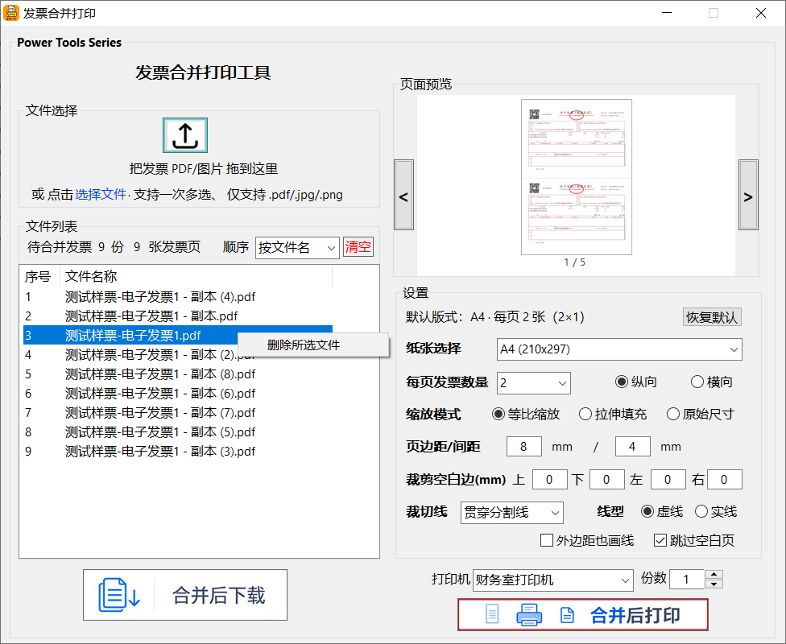

# 发票合并打印工具（Invoice-Print）

一款面向财务、行政及日常办公场景的本地桌面软件，用于将多张电子发票（支持 PDF、JPG、PNG 格式）按照指定版式合并排版到一张纸上，再统一打印或下载，大幅减少逐张处理的工作量。

软件采用纯本地运行方式，所有发票数据仅在电脑内处理，不上传网络，适合涉及票据信息等敏感内容的场景，安全可控。

---

## 一、核心功能

### 1.1 批量导入
支持将发票文件直接拖入窗口或点击选择，一次可多选；支持 PDF、JPG、PNG 格式，自动识别并去重，按文件名排序，并支持多页 PDF 的逐页处理。

### 1.2 列表管理
文件列表清晰展示序号与文件名，支持整行高亮选中、右键删除单份、一键清空，方便对合并前的文件进行核对与管理。

### 1.3 灵活排版
提供丰富的版面设置：
- 纸张规格可选 A4、A5、B5；
- 每页发票张数支持 1、2、3、4、6、8、9 张；
- 可自由选择纵向或横向纸张；
- 缩放模式提供等比缩放、拉伸填充、原始尺寸三种；
- 页边距与间距可调；
- 支持对上、下、左、右空白边进行裁剪；
- 裁切线可设置贯穿分割线、线型（虚线/实线）及外边距是否画线；
- 还可跳过空白页。

### 1.4 自动方向匹配
软件会依据纸张方向与每页张数，自动将发票旋转到正确的摆放方向（纵向时 1/4/9 张竖放、2/3/6/8 张横放，横向时规则相反），无需手工逐张调整，保证拼版效果规范统一。

### 1.5 实时预览
内置所见即所得的预览窗口，逐页显示即将合并的缩略图，左右两侧可翻页查看，底部页码稳定常显，并清晰显示纸张边界，让用户在打印前即可确认版面效果。

### 1.6 合并下载与打印
一键将多张发票合并为整页结果：可选择合并后下载（输出为 PDF 文件），也可选择合并后打印，支持指定打印机并设置打印份数，按纸张方向正确输出。

---

## 二、优势特色

- **高效便捷**：内置渲染缓存，同一文件无需重复解析，批量合并速度快，响应灵敏。
- **灵活多样**：纸张、张数、方向、缩放、边距间距、空白裁剪等全面可调，适配不同发票尺寸与纸张规格。
- **智能排版**：发票方向自动匹配规则，减少手工调整，拼版结果规范一致。
- **安全可靠**：纯本地处理，发票数据不出电脑，不上传任何服务器。
- **轻量易用**：单文件免安装，渲染引擎内嵌于程序，即开即用，无需额外配置。
- **打印下载一体**：既可导出合并文件，也可直接打印，一份完成多张纸批量输出。

---

## 三、适用场景与使用流程

适用于报销凭证打印、发票归档整理、多张发票拼版输出等日常财务与行政场景。

整体使用流程为：**导入发票文件 → 选择版式与参数 → 预览核对 → 合并打印或下载**，几步即可完成批量发票处理。

---

## 四、运行时依赖

本工具处理 PDF 时需要 MuPDF 的 `mutool.exe`（约 46MB）。该文件体积较大，不纳入 Git 仓库，改为通过 Github Releases 分发：

- 下载地址：<https://github.com/PowerWorkspace/Invoice-Print/releases/tag/runtime-deps>
- 将下载的 `mutool.exe` 放入项目 `res/` 目录后，即可正常构建与运行。

---

## 五、开发更新日志

### v1.0.0 初始版本
搭建软件主界面与整体功能框架。实现发票文件导入能力：支持拖拽或点击选择文件，兼容 PDF、JPG、PNG 格式，可一次多选，自动去重并按文件名排序；实现文件列表展示与整行高亮。

### v1.1.0 排版与合成
实现核心合并排版能力：支持纸张规格（A4/A5/B5）、每页发票张数（1/2/3/4/6/8/9）、纵向与横向方向、三种缩放模式、可调页边距与间距、四向空白边裁剪、裁切线样式、跳过空白页与打印份数设置。
引入 MuPDF（mutool）渲染引擎，支持多页 PDF 的逐页渲染与合成。

### v1.2.0 预览功能
新增预览窗口，可逐页显示即将合并的缩略图，左右两侧提供翻页按钮，底部页码稳定常显，并清晰显示纸张边界。
修复预览相关问题：页码在翻页时闪现、翻页按钮在浅色背景上不可见、预览空白等，保证预览体验稳定清晰。

### v1.3.0 打印与下载
实现合并后下载与合并后打印。合并后下载将合成结果输出为 PDF 文件；合并后打印支持选择打印机、设置打印份数，并按照纸张方向正确输出。

### v1.4.0 稳定性与性能
修复多项稳定性问题：添加文件后未进入列表、多张文件时出现报错、列表列错位、文件拖放与选择交互异常等。
引入渲染缓存机制，按文件修改时间复用已渲染页面，显著提升批量处理的响应速度，解决界面下拉选择与输入卡顿问题。

### v1.5.0 方向逻辑完善
依据预览图示完善发票在纸张格内的摆放方向规则：纵向纸张下每页 1/4/9 张时发票竖放、2/3/6/8 张时横放，横向纸张规则反向。
修复发票方向判断异常（因条件判断写法导致纵向 4/9 张方向错误），最终各项版式的发票方向与规则完全一致。

### v1.6.0 打包发布
将软件打包为独立 EXE，渲染引擎内嵌其中，用户无需额外安装环境即可直接运行使用。

> 备注：以上版本号与迭代时间节点为整理归纳，可根据实际发布节奏与需求做相应调整。

---

## 六、仓库信息

- 源码分支：`main`
- 仓库地址1：<https://gitee.com/powerclub/Invoice-Print>
- 仓库地址2：<https://github.com/PowerWorkspace/Invoice-Print>

## 七、开源许可

本项目采用 **MIT License** 开源许可，允许任何人免费使用、复制、修改、合并、发布及分发本软件（含商业用途），只需在副本中保留原版权声明与许可声明。

- 许可证文件：仓库根目录 `LICENSE`
- 第三方依赖提示：本工具运行时调用 MuPDF 的 `mutool`（AGPL-3.0 协议），以独立可执行文件形式经 Releases 分发、未并入源码。如你修改并再分发本工具，请留意 MuPDF 的许可证义务。
